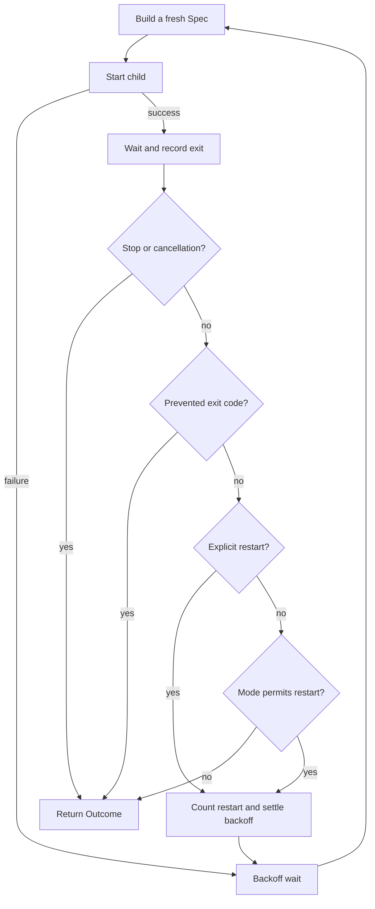

# Supervision and restart policy

`NewSupervisor` validates options without launching anything. Call `Run` exactly
once; a second call panics. `Stop` is idempotent and safe even before `Run`.
`Run` returns only after the final child is cleaned up, then closes `Events`.

The exit is recorded before deciding whether to restart. Unconfirmed cleanup is
checked first and is terminal: `Outcome.Reason` is `CleanupFailed`, `Outcome.Err`
wraps `ErrCleanupUnconfirmed`, and no automatic or requested restart can start
another generation. The same barrier applies to a failed `Start` with an
unconfirmed `StartError`, even if Stop or cancellation raced it. A safe
pre-spawn failure or confirmed post-spawn failure follows normal retry policy.
For confirmed exits, Stop or context cancellation takes precedence. Next,
`PreventExitCodes` is checked: a matching code returns `Completed` and the final
`Last` exit, even with a pending explicit restart. An explicit `Restart` then
overrides `Mode` and relaunches.
For a confirmed unit, an I/O or close diagnostic does not itself block
`RestartAlways`; `RestartOnFailure` keeps its exit-code policy. Cleanup safety,
not the mere presence of `Err`, is the restart barrier.

For example, an application may define code 42 to mean “configuration must be
repaired.” The library assigns no meaning to 42. The consumer sets
`RestartPolicy{PreventExitCodes: []int{42}}`, then inspects
`outcome.Reason == Completed` and `outcome.Last.Code == 42` to take its own action.
It may fix configuration or notify its own UI; procguard only reports the result.

Every approved relaunch after an exit increments `Restarts`. Spawn failures,
including factory errors, advance backoff and retry but do not increment this
counter. `Launches` counts successful starts.

`Backoff.Next` records failures and produces 1s, 2s, 4s, and so on, capped at the
maximum (60s by default). `Current` is zero before a failure. `Saturated` is false
until a failure reaches the maximum. `Stable(runtime)` includes equality to the
threshold (five minutes by default). Non-positive constructor values use defaults.
A zero-value `Backoff` is usable. Do not copy it after use. Normally give each
supervisor its own backoff; deliberately sharing one shares its failure streak.

`Restart(true)` stops the current child, resets backoff, and skips delay.
`Restart(false)` follows the ordinary failure path. `MarkStable` marks only the
current launch, including inside its successful `AfterStart`; it does nothing during backoff. On that launch's exit,
either this mark or enough runtime resets the streak, then `Next` gives the delay.
Readiness and health checks belong to the consumer.

During backoff either restart form interrupts the wait. Concurrent requests
coalesce, with immediate requests winning. Restart after Stop is a no-op.
All delay waits are interruptible by stop or cancellation. A stop that lands
before, during, or after spawn publication remains effective; it cannot be lost.

`Outcome.Reason` is `Stopped`, `Cancelled`, `Completed`, or `CleanupFailed`.
Explicit stop takes precedence over cancellation only after cleanup is confirmed;
`CleanupFailed` wins whenever final cleanup is unknown. `Outcome.Cleanup` is the
authoritative terminal confirmation, including when no launch succeeded, and
`Outcome.Err` contains the terminal Start/supervision/I/O error as text in
serialized protocols. A confirmed nonzero exit is represented by `Last.Code`,
not a fabricated error. `Last` is nil if no launch succeeded, and an earlier
confirmed `Last` never makes a later unsafe start safe.
`EventStopped.Err` carries the terminal error when cleanup is unconfirmed; events
are lossy notifications, so `Outcome` remains authoritative.
